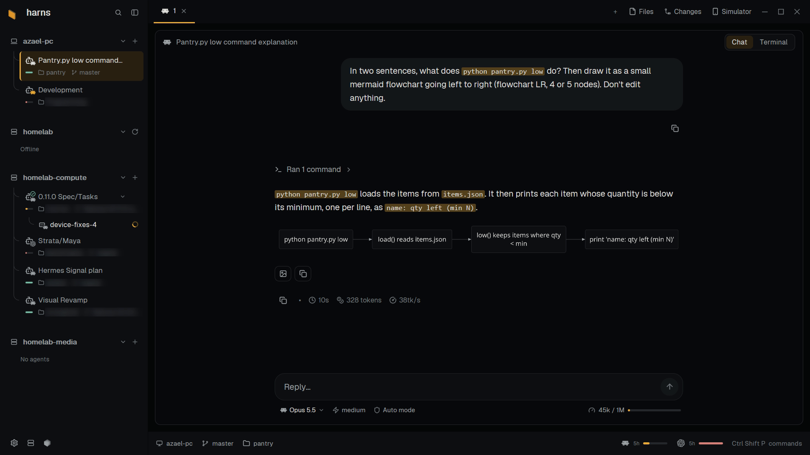

# harns

Layouts and mods for the [Herdr](https://herdr.dev) app, in one repository:

| Listing | What it is | Folder |
|---|---|---|
| **harns** (layout) | A window organized by machine: each machine's agents in the sidebar, agent tabs as a chat or a terminal, Claude Code and Codex quota in the status bar | [`layouts/harns`](layouts/harns/RECIPE.md) |
| **herdr-chat** (layout) | An agent's terminal shown as a chat, with a Chat / Terminal toggle | [`layouts/herdr-chat`](layouts/herdr-chat/RECIPE.md) |

Each folder is one listing on herdr.dev: its `RECIPE.md` (the brief to build it from), its `preview.png`, and the files
an agent copies to add it. The rest of this page is about harns.

harns is a herdr layout organized by machine: each machine's CPU, RAM and GPU load and its agents in the sidebar, agent
tabs as a chat or a terminal, and Claude Code and Codex quota in the status bar. Everything goes through herdr's own
machine connections.

[Its RECIPE.md](layouts/harns/RECIPE.md) describes it in full, as a brief to build it from.

## Features

**Organized by machine.** Each machine in the sidebar lists its agents with their folders, branches and context, and
its plain terminals, hanging from it on lines; the Classic style boxes each machine with its system (Windows, macOS or
the Linux distribution) and its CPU, RAM and GPU load, which the machine's card shows in either. Its **+**
starts an agent there from the ones installed on it, or a terminal, a new space or a worktree. Alt+Up and Alt+Down
walk the agents; Alt+Shift+Up and Alt+Shift+Down jump to the next machine's. Alt+Left and Alt+Right
switch an agent's tab between Chat and Terminal.

**Details on hover.** Rest on an agent for its status, space, folder, branch and context window, or on a machine for
its system, CPU, memory, GPUs and disks.

**A chat for every agent.** An agent's tab is a chat ([herdr-chat](layouts/herdr-chat/RECIPE.md)) or its
live terminal, one click apart. Mermaid diagrams in replies are drawn by [Pele](https://github.com/obsidianmd/pele).

**Something to look at while it starts.** A new conversation opens on a dimmed animation behind its welcome: sharks,
jellyfish, a night sky or rain.

**Markdown, rendered.** Click a Markdown or `.mmd` file in the Files panel and it opens rendered in a floating
window, with its images and mermaid diagrams.

**An Android emulator per session** (Windows and Linux). The Simulator panel runs one beside each agent, shared with the machine
the agent runs on (below).

The status bar shows the Claude Code and Codex quota left.

**Settings of its own.** The harns logo in the sidebar's footer opens harns's Settings: this computer's name, the
sidebar's style (Tree, agents hanging from their machine on lines, or Classic, each machine boxed with its agents and
stats), whether agents open as a chat and the welcome's animation, what the status bar shows, and whether the tab bar
offers the Simulator. Drag a machine's band to reorder the machines in the sidebar.

## Install

Needs the Herdr app and Python 3 on each machine. The chat in agent tabs is herdr-chat, one of
harns's mods: the installer installs it with the rest (`--no-chat` leaves an installed copy as it is).

Ask your agent to add this layout, or run `./install.sh` from a clone (on Windows, from Git
Bash, or run `python scripts/install.py` in PowerShell, with the same options). It builds the
generated files, copies the mods, theme, assets and layout into
`~/.config/herdr-app` (or `HERDR_APP_HOME` when it's set), sets the icon and tint for Codex,
Claude Code and Pi in your `programs.json` (its other entries stay as they are), adds the layout's
keys to your `keys.json` (only keys you haven't bound for `harns`), checks every mod,
installs this computer's relays (below) and switches to `harns` (`--no-switch` to
skip). `ctrl-shift-l` switches back. A `harns` layout you
changed is kept beside the new one as `harns.json.before-install-<time>`.

Optional:

- **Context bars** (on each agent's card) come from relays: Claude Code's status line and a Pi extension
  (`scripts/install-context.py`, on Windows, Linux and macOS). Codex's comes from its log
  (the one herdr-chat found for it), else its footer, when `context-remaining` is one of its
  `tui.status_line` items. The Claude Code and Codex
  quota bars read the account from each service and need no relay.
  The installer sets the relays up on this computer (`--no-relays` to skip);
  for each connected machine run `python scripts/install-context.py --on MACHINE`. They write:
  - `~/.config/harness/context-relay.py`, and the snapshots it keeps in `context/` beside it;
  - `~/.pi/agent/extensions/harness-context.ts`;
  - `statusLine` in `~/.claude/settings.json`, after copying the file to
    `settings.json.before-harness-context` once. A status line you had is kept in
    `~/.config/harness/claude-statusline-original.json`, and the relay still runs it;
  - in `~/.codex/config.toml`, only removing a `notify` line an older relay added.

  Pi sessions already running pick up the relay after `/reload`, typed in their terminal.
- **Simulator** (Windows and Linux): the panel beside Files and Changes runs Android virtual devices
  from the Android SDK (`ANDROID_HOME`, else `%LOCALAPPDATA%\Android\Sdk` on Windows and `~/Android/Sdk` on
  Linux). [RECIPE.md](layouts/harns/RECIPE.md)'s "Simulator setup" lists what to install and how to create a device. Each session (an agent's tab) gets its
  own emulator, and its sub-agents use the same one; when another session needs one, the panel
  copies a virtual device for it. The panel shows the focused session's emulator, its own
  window placed over the panel so it runs at full speed with its own input, and the others
  keep running, hidden. That's on Windows and on Linux under Hyprland; on other Linux desktops each
  emulator opens in its own window, and the panel's buttons work the same. Stop saves where Android was, and the next Start resumes it; Restart
  (the circular arrow) shuts the emulator down and boots it fresh, keeping its apps and data.
  Closing a tab stops its emulator and keeps the device. For Expo apps,
  run `expo start` and open the dev build as usual. The iOS Simulator needs a Mac.

  Each emulator starts with 4 GB of RAM, 4 cores and the graphics card (`-gpu host`), over what
  its virtual device says; storage is the virtual device's own. These are limits rather than
  reservations: cores are threads the system runs anywhere, and memory is taken as Android uses
  it (though memory Android has filled isn't given back until the emulator stops). The defaults
  are in the Simulator mod's `emulator.json` (`src/harns-emulator/emulator.json` here); change them in `~/.config/herdr-app/harness.json`,
  which updates don't overwrite, as `{ "emulator": { "default": { "memory": 6144 }, "devices":
  { "harns_phone": { "cores": 6 } } } }` (`memory` in MB, `cores`, `gpu`; `devices` by a virtual
  device's name, for that one only). The panel title's tooltip shows what the session's emulator
  uses. A new value applies the next time it starts; one the emulator wouldn't take is left out
  and named while it starts.

  Sessions on other machines reach their emulator with that machine's own `adb`. The panel
  shares each one there through an SSH reverse tunnel, listening only
  on that machine's localhost (on Linux, a forward on herdr's own connection to the machine, so
  no ssh key is needed; on Windows, or with no herdr connection, OpenSSH with herdr's ssh config,
  so ssh to it needs to work with a key), and installs a small `~/.local/bin/adb` script there that points
  each session's terminals at their own emulator before running the machine's own adb. In
  that session, `adb devices` lists its emulator (and any phones, but not other sessions'
  emulators), and `adb`, `adb install` and `expo run:android` reach it. An `adb` already in
  `~/.local/bin` that isn't harns's is left alone. If that machine's adb server restarts, or a
  connection drops, the panel connects it again within a minute. A share that can't be set up
  (no way to ssh in, someone else's `adb` there) shows why and is tried again later, less and less often.
- **This computer's name:** it shows the computer's own name. For a nickname, set Name in harns's Settings
  (General), or put `{ "localMachineName": "my-pc" }` in `~/.config/herdr-app/harness.json`.

## Platforms

| | CPU and RAM | GPUs | Simulator |
|---|---|---|---|
| Windows | PowerShell counters | NVIDIA | In the panel |
| Linux | Python 3, `/proc` | NVIDIA | In the panel on Hyprland, else its own window |
| macOS | Python 3, `top` and `vm_stat` | — | — |

Each machine's platform is detected once (`src/shared/platforms.js`). GPU vendors
are entries in `src/shared/gpus.js`, with a place for AMD, Intel and Apple.

## Working on it

- Each mod's source is in `src/`; what several share (code, and the one icon set in `src/shared/icons/`) is in
  `src/shared/`, and a mod gets what it imports or names when it's built. The listings' `mods/` folders are built
  from it by `scripts/package.py`: don't edit them. Edit `src/`, then run the installer (`--no-switch --no-relays`
  while developing): it builds the listings and copies harns's into `~/.config/herdr-app`.
- A listing is a folder under `layouts/` (or, for a mod on its own, `mods/`) with its `RECIPE.md`, `preview.png` and
  files; `package.py`'s `LISTINGS` says which mods each one ships.
- Check with `herdr-app check <mod folder>`, `herdr-app status` and `herdr-app shot`.
- Tests: `npm test` runs them all (the Python unit tests, harns's and herdr-chat's Node and Python tests, a check that
  the vendored Pele matches its pin, after `npm install` byte for byte, and a check that every listing is built from
  the current `src/`). A few of the chat's tests need Linux or macOS and say they're skipped on Windows. It finds Python 3
  as `python3`, `python` or `py -3`, so it runs as installed on Windows, Linux and macOS. The
  stats and account probes are tested the way each platform runs them: PowerShell on Windows,
  Python on Linux and macOS.
- `markdown-files` is herdr's Files panel where Markdown and `.mmd` files open in a floating window as a readable
  document: images (beside the file or on its machine; web images show as links, never fetched) and
  mermaid blocks drawn by Pele (the same vendored copy as herdr-chat's). Preview and
  Source in its header switch views. To update Pele, change the pin in `package.json`, then run
  `npm install && npm run vendor:pele`.
