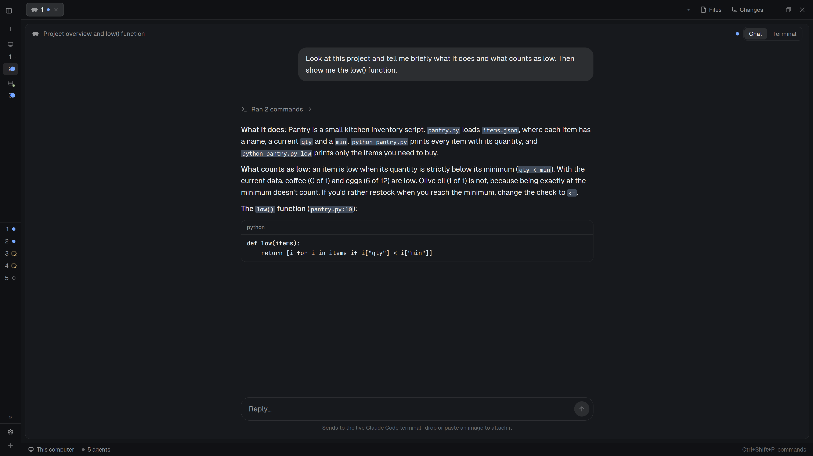

# Herdr Chat

A coding agent's terminal, shown as a chat. A Chat / Terminal toggle in the
pane header swaps one for the other in place, and the agent keeps running in its terminal either
way. The chat reads the agent's own session log, so it works for agents on every machine herdr
reaches.



## Install

Ask your Herdr agent to add this layout, or copy `mods/agent-chat/`, `layouts/herdr-chat.json` and its picture
for Herdr's layout picker, `layouts/herdr-chat.svg`, into `~/.config/herdr-app/` and switch to `herdr-chat` with `ctrl-shift-l`. Your own layout stays
as it was, one `ctrl-shift-l` away.

Each machine with agents needs Python 3: `python3`, or `py -3` / `python` on Windows.

**To add the chat to your own layout**, wrap its `{ "tab": "active" }` block in this stack and give
its pane look the mod as a header. The mod looks for these names:

```json
{ "id": "chat-view", "type": "stack", "active": "chat-panel", "children": [
  { "id": "chat-panel", "type": "block", "content": { "mod": "agent-chat", "props": { "role": "chat" } } },
  { "id": "terminal-panel", "type": "block", "content": { "tab": "active", "pane": {
      "header": { "content": { "mod": "agent-chat" }, "height": 42, "position": "top", "reveal": "always" } } } }
] }
```

## What you see

The layout is herdr's `main` (Spaces and Agents on the left, tab pills, Files and Changes panels,
status bar) with the chat and the terminal sharing the work area.

- **Header** (42 px, on both views): the program's icon, name and folder; on hover split right,
  split down, zoom and close; the agent's status (a spinner while working, "Needs you" while
  blocked, a dot when it finished while you were away); and the **Chat | Terminal** toggle at the
  far right.
- **Chat** (a centred column, 740 px wide):
  - your messages as bubbles on the right, with their images above them as 120 px thumbnails;
    the agent's replies on the left as markdown, with code blocks;
  - tools and thinking folded into one grey line per run ("Ran 3 commands, read 2 files ›"),
    opening to each step with its output;
  - mermaid blocks drawn as diagrams in the reply;
  - while the agent works, an accent spark and its live status;
  - a question card above the reply box when the agent asks something;
  - a reply box that grows to four lines, with a round send button in the theme's accent (a Stop
    button while the agent works); under it, the model (a menu to switch it), effort, mode and
    context used, or a line naming the terminal it sends to until those are known;
  - a jump-to-bottom button when the newest message is off screen.
- **Empty chat:** herdr's logo with "Opening this … conversation…", "Waiting for this …
  conversation to start." or "No messages in this session yet." With the block's `backdrop` prop, a dimmed
  animation (sharks, jellyfish, a night sky or rain) plays behind it, unless shared `herdr-chat.animation` is false
  (harns's Settings sets it).

Colours come from the active theme; icons are the mod's own SVGs in the theme's text colour.

## How it behaves

- **Agents:** a terminal gets the toggle when its program has an adapter in `harnesses/` (see
  Adding an agent below). Every other tab shows its terminal.
- **View:** a new agent session opens on Chat. Each session keeps the view it was left in, across
  restarts (the latest 200, shared key `herdr-chat.views`). Shared `herdr-chat.chat` false (harns's Settings sets
  it) keeps every tab on its terminal, without the toggle.
- **Session logs:** the log each session reads is kept across restarts (the latest 200, shared key
  `herdr-chat.paths`, by address and start: `{ path, hint, cwd }`). `cwd` is the folder a Pi or Codex
  session works in, as its log says, which can differ from the terminal's after a resume; other mods
  read it (harns's agent cards).
- **Sending:** Enter sends, Shift+Enter starts a new line, ↑ and ↓ move between lines. The text
  reaches the live terminal as plain typing (`hc send` from the agent's machine, without hc's
  `<hc from="…">` wrapper). A send that can't be delivered puts the text back in the box.
  Codex is the exception when its app-server daemon has the conversation open (Codex's default): the
  message and its images go to the daemon as a new turn, or into the turn it's running, as Enter
  does in its terminal, and the terminal shows them as if typed. Answers to a waiting prompt,
  `/commands`, `!shell` lines and messages naming a `$skill` are still typed, since only the
  terminal understands them, as is everything in a conversation the daemon has closed.
- **Layout keys:** Alt+Shift+Up and Alt+Shift+Down, which the reply box's text input would otherwise take,
  run what `keys.json` binds them to for the shown layout, else globally (`keys.js`).
- **Stop:** while the agent works, the send button stops it (also Esc). A message the agent hands
  back on Stop returns to the reply box.
- **Images:** drop png, jpg, gif or webp files on the chat, or paste one with Ctrl+V. Images over
  250 KB are shrunk, placed beside the agent's terminal with `hc put`, and attached the way each
  agent attaches images: Claude Code as an `@path` mention, Codex as a pasted path, Pi and OpenCode
  as the plain path. Images in the conversation show as thumbnails, fetched from the agent's
  machine.
- **Questions:** when an agent asks a question with choices, the card lists them: ↑↓ move, Enter
  or a click answers, multi-select questions tick rows, multi-step questions step through, and
  Claude Code's previews show beside the options. A typed answer's box wraps and grows to 3 lines, then scrolls, and
  the options grow with it; Enter sends it (Shift+Enter is a new line), as in the reply box. The card folds to one
  line. Each key is sent
  only while the screen still shows the same question. Other prompts show the screen's last lines
  with key buttons. Codex's command and file approvals and its questions come from its daemon
  instead of the screen, with the choices Codex offers, and a click answers them there; the
  terminal's dialog closes with it. The chat joins only a conversation the daemon already has
  open, and leaves its settings as they are.
- **Skills:** typing `/` (also `$` on Codex, `@` on OpenCode) opens the agent's skills: ↑↓ choose,
  Enter or Tab insert, Esc closes.
- **One draft:** on Linux and macOS, the reply box and the agent's own input box share one draft,
  images included, as you switch between Chat and Terminal.
- **Reading:** each session log is found once and remembered. The first read takes its last 24 MB
  (up to 400 entries), and later reads take what was added. Agents are read again whenever herdr
  reports a change in them, and the working agent on screen every 1.5 s. The 32 most recent
  conversations stay in memory, so switching back is instant.
- **Following:** the chat stays at the bottom while you're there, and holds still when you scroll
  up.
- **Highlight:** selected text, in the chat and in herdr's text boxes, uses a dimmed accent.

## Built from

**Layout** `layouts/herdr-chat.json`: `main` with its tab block inside the `chat-view` stack above.
The swap is `layout.select { stack: "chat-view", child: "chat-panel" | "terminal-panel" }`, since
the terminal itself belongs to the layout. The same mod runs twice: as the chat
(`props.role: "chat"`) and as the terminal's pane header (it gets `{ pane, terminal }`).

**Mod** `mods/agent-chat/` (`mod.json` is `{"place":"none"}`; built from the repository's `src/agent-chat` by `scripts/package.py`):

| Path | Role |
|---|---|
| `main.js` | the chat view: sessions, timers, header, list, card and composer, Stop |
| `header.js` | the terminal pane header with the toggle |
| `common.js` | session keys, each session's view, `layout.select` |
| `components/` | `chat-list.js` (rows, measuring, following), `question-card.js`, `composer.js` (reply box, drafts, images, sending), `session-reader.js` (reading and keeping conversations), `skill-menu.js` |
| `model/` | pure data, free of gpui and herdr imports: transcript folding, session state, prompt parsing, caret, hash |
| `ui/` | `primitives.js` (icons, buttons, badges, toggle) and `rows.js` (each conversation row) |
| `harnesses/` | one adapter per agent: label, image style, drafts, prompt options, input box, skills, reader. All agent-specific behaviour lives here |
| `readers/` | the session reader in Python 3.6+, one file per agent beside `common.py` and `main.py`, joined in `manifest.json` order |
| `keys.js` | the composer's key bindings, and the layout keys it passes on to `keys.json` |
| `terminal.js`, `platform.js` | the target agent and its screen; Windows and Unix differences |
| `images.js`, `prepare-image.sh` / `.ps1` | image previews: where they go, shrinking, the clipboard |
| `input-box.py`, `send.ps1` | the agent's own input box through `hc attach` (Linux and macOS); sending on Windows |
| `diagrams.js`, `diagram-copy.js`, `vendor/pele/` | mermaid through [Pele](https://github.com/obsidianmd/pele), pinned in `package.json` and copied into `vendor/`: the engine (shared with harns's Files panel, drawing into `cache/diagrams`), and the chat's splitting of a message around its diagrams and copying one as a picture |
| `icons/` | the mod's SVG icons (from the repository's one set, `src/shared/icons`) |

## Watch out

**What it accesses:**

- runs programs, on this computer and on other machines (`exec(…, { on })`): `python3` (`py -3`
  or `python` on Windows), `hc` (`send`, `keys`, `interrupt`, `put`, `get`, `ls`, `exec`, `read`,
  `attach`, including `attach --observe`), `sh`, `env`, `rm`, `find`, `powershell.exe`, the
  clipboard tools (`wl-paste`, `xclip`, `pngpaste`) and ImageMagick or `sips`. The reader travels
  with each run, so other machines need only Python 3 and `hc`;
- connects to Codex's app-server daemon (`~/.codex/app-server-control/app-server-control.sock`, or
  under `CODEX_HOME`) from the reader, to read and answer a conversation's approvals and send its
  messages;
- reads the agents' session logs (`~/.claude` or the `CLAUDE_CONFIG_DIR` a Claude Code process was
  started with, including its `sessions`, `~/.codex/sessions`,
  `~/.pi/agent/sessions`, OpenCode's database), their skill folders, terminal screens, and the
  process list, to find which session runs in each terminal;
- types into terminals and stops a working agent with its own stop key;
- writes image copies under `cache/agent-chat/` and drawn diagrams under `cache/diagrams/` in the Herdr home, and deletes
  its own files there after a day (delete that folder along with the mod to remove everything);
- sets the app's `accent` and `selection` colours to a dimmed accent while it runs, so selected
  text stays visible in herdr's text boxes. Theme files stay as they are;
- works entirely offline.

**Notes for building it:**

- **Windows command line:** the reader is longer than Windows' 32,767-character command line, so on
  Windows the mod loads it from `readers/` for local agents and sends it zlib-compressed to other
  machines. Elsewhere it's sent whole.
- **Windows processes:** the reader walks a terminal's processes through `kernel32` on Windows and
  `/proc` or `ps` elsewhere. Python on Windows ends lines with `\r\n`, so split batch output on
  either.
- **Binary files:** read a written image back to confirm its size before using it.
- **Thumbnails:** `image()` draws files inside the herdr home, so each preview is a copy in
  `cache/agent-chat/sent/`.
- **Diagrams:** write the theme's colours into Pele's SVG directly; herdr's SVG renderer draws
  inline colours.
- **List rows:** handle clicks with the virtual list's `on_item_click`.
- **↑ and ↓:** bind them in the textarea's `Input` context, and read the caret by typing an
  invisible marker (`model/caret.js`).
- **Sizes:** measured sizes include the app's zoom and layout sizes take unzoomed px, so every
  measured size goes through `measure.js`.
- **Theme colours:** `set_theme` restarts every mod copy, so apply it from a timer and only when
  the colour changed.
- **Sending:** send from the agent's machine without `HC_TERMINAL_ID` and `HC_SCOPE`, so the text
  arrives as plain typing.
- **Debug files:** write them outside the mod's folder, since any write inside reloads the mod.
- **Its name:** `mods/agent-chat/` is written into its paths (`platform.js`, `common.js`,
  `terminal.js`, `components/session-reader.js`) and its shared keys start with `herdr-chat.`,
  so a renamed copy needs those changed too.
- **Agent logs:** Codex continues a resumed session in its older logs and splits long ones into
  parts, and writes its reviewer's logs beside them (read only the session's own). Claude Code logs
  messages sent mid-turn as `queued_command` attachments. A resumed Pi keeps writing to its first
  file.
- **Adding an agent:** a `harnesses/<id>.js` adapter listed in `harnesses/index.js`, and a
  `readers/<id>.py` registering `READERS["<id>"]` listed in `readers/manifest.json` before
  `main.py`. `tests/harnesses.mjs` checks that agent names stay inside `harnesses/`.

**Platform notes:**

- The chat shows the last 24 MB of each session log.
- On Windows, the draft lives in the reply box, a question card shows long previews in part with a
  count of the remaining lines, a multi-select's own-answer row is typed in the terminal, and Codex
  receives a pasted image as its path.
- OpenCode is read from its `session_v2` tables.

## Done when

- `herdr-app check ~/.config/herdr-app/mods/agent-chat` passes and `herdr-app status` shows no
  errors on the `herdr-chat` layout.
- `npm test` passes on Linux or macOS.
- A new tab for each supported agent opens on its chat, with the toggle in the header;
  Terminal brings the terminal back, and each session keeps its view after a restart.
- A message sent from the chat reaches the terminal as plain text, and the reply appears as it's
  written.
- An agent on another machine shows its conversation the same way.
- A pasted screenshot shows as a thumbnail and reaches the agent as an image.
- A question with choices shows as a card, and answering it in the chat answers it in the terminal.
- A mermaid block shows as a diagram in the theme's colours.
- Changing the theme changes the chat's colours.
